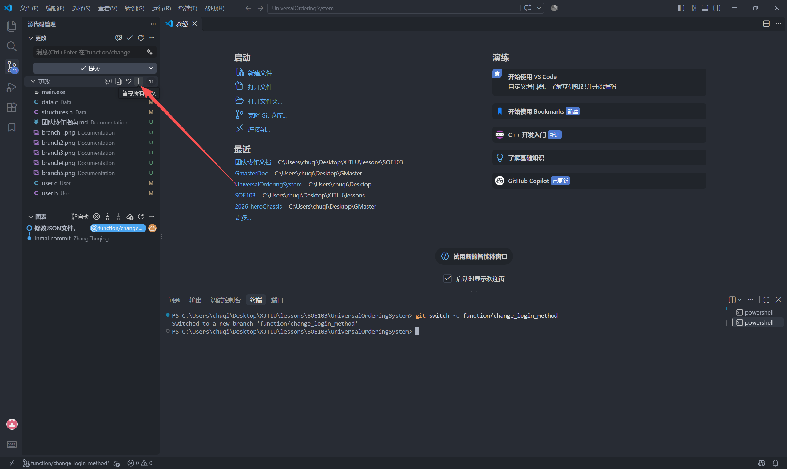
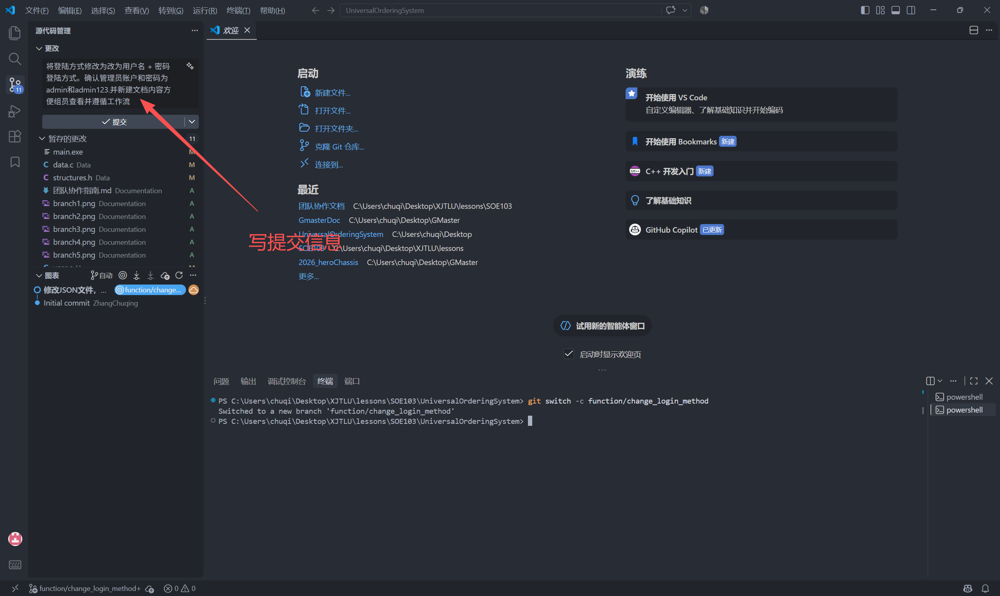
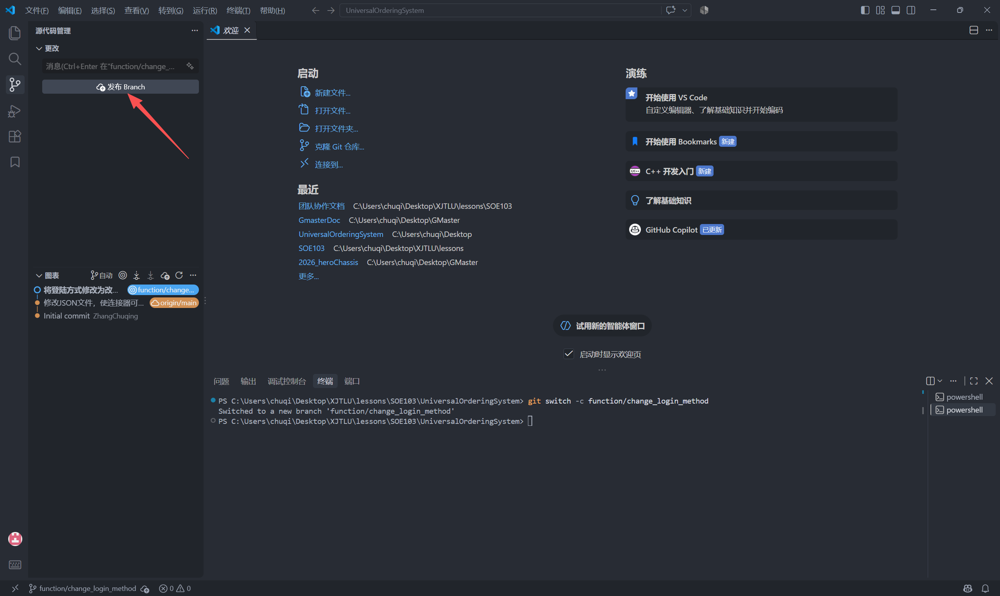
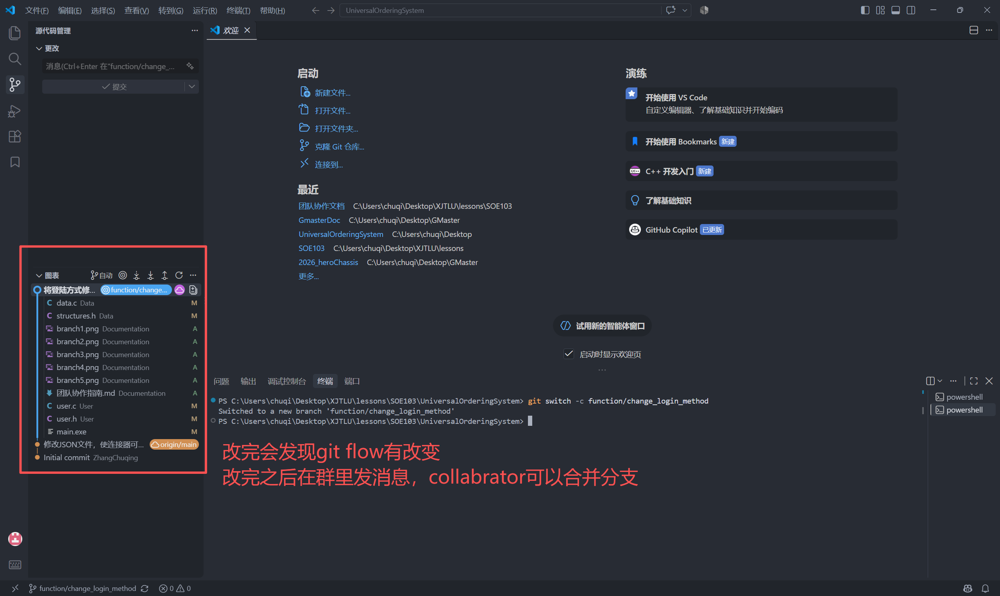

# Git 共同开发工作流

###### V 0.0.1

###### 最后一次修改时间：2026.22.18

###### 作者：张楚清

> 本文件主要讲解图形化的git使用方法，命令行讲解请参考[Git - Gmaster Documentation](https://www.gmaster.wiki/%E8%BD%AF%E4%BB%B6%E7%BB%84/%E5%BC%80%E5%8F%91/Git/#git_1)

## 第一部分：核心概念与基础

### 什么是版本控制？

**版本控制就是一种记录和管理文件变化历史的系统**。在软件开发中，我们经常需要修改代码，而这些修改往往涉及多个文件。如果没有版本控制系统，我们很难追踪谁做了什么改动、什么时候做的、为什么要做这些改动。更糟糕的是，当我们发现某个改动导致了 bug 时，我们几乎无法快速恢复到之前的状态。

**Git** 是当今最流行的分布式版本控制系统，它允许我们：

-  记录每一次代码改动

-  随时回到任何历史版本

-  创建多个分支进行并行开发

-  与团队成员协作开发

-  追踪谁做了什么改动

### 工作区、暂存区和版本库

在使用 Git 前，必须理解两个核心区域的概念：

```
本地仓库（local）
    - 你本机上的完整 Git 仓库
    - 包含所有分支和提交历史
    ↓ git push / pull
远程上游仓库（upstream）
    - 原始的、官方的项目仓库
    - 所有贡献者的代码最终都会合并到这里
```

## 第二部分：使用方法

### 分支 (Branch)

分支是指向某个特定提交的"指针"。主分支（本仓库中叫 `main`）是项目的主线，而其他分支则允许你在不影响主线的情况下进行独立的开发。

用法：


### 提交 (Commit)

每一次 `git commit` 都会创建一个快照，记录当前项目的完整状态。每个 commit 都包含：
- 作者信息
- 提交时间
- 提交信息（描述这次改动做了什么）
- 唯一的 commit hash（哈希值，用于标识这个提交。如果代码后续崩溃，便于回滚到以前的版本）

用法：



